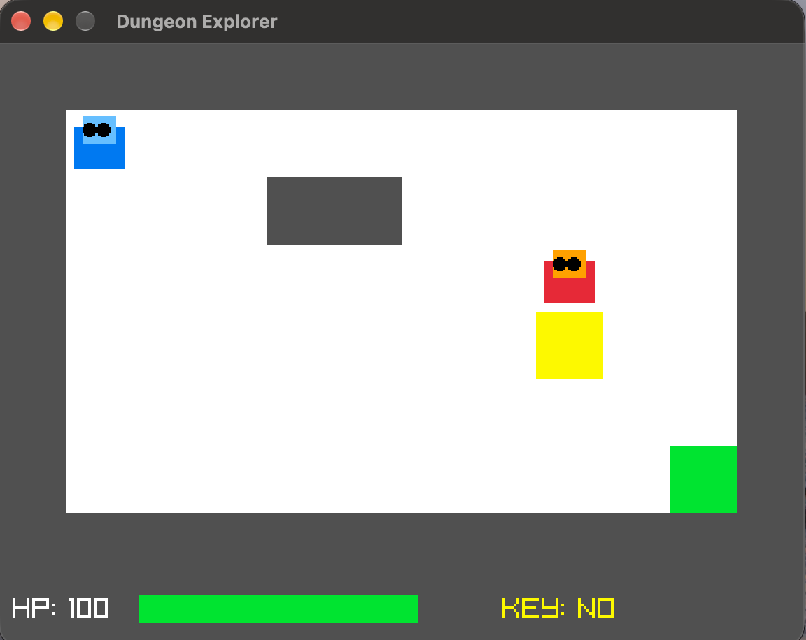

# 24h-dungeon-explorer

A 24-hour C++ game development challenge using raylib.

## Overview

Dungeon Explorer is a simple 2D dungeon game built with C++ and raylib. The player must collect a key and reach the exit to win. An enemy chases the player and attacks when adjacent. The player can fight back or avoid the enemy.

## Features

- Tile-based dungeon with walls, a key, and an exit.
- Player movement and collision detection.
- Turn-based combat system.
- Enemy AI using a simple greedy chasing algorithm.
- Health bar and key status display.
- Victory, Game Over, and restart functionality.
- Custom characters drawn using raylib shapes.

### Character Stats

| Character | HP | Attack Damage |
|---|---:|---:|
| Player | 100 | 20 |
| Enemy | 50 | 10 |

## Controls

| Key | Action |
|---|---|
| Arrow Up | Move up |
| Arrow Down | Move down |
| Arrow Left | Move left |
| Arrow Right | Move right |
| Space | Attack |
| R | Restart the game |

## Requirements

- C++17
- raylib
- pkg-config
- macOS with Homebrew (for the instructions below)

## Build and Run

Install the dependencies:

```bash
brew install raylib pkg-config
```

Compile the game from the project root:

```bash
clang++ -std=c++17 src/main.cpp src/Game.cpp -o dungeon_explorer $(pkg-config --cflags --libs raylib)
```

Run the game:

```bash
./dungeon_explorer
```

## Development Notes

This project was created as a 24-hour C++ development challenge.

The main goals were to practice C++ programming, understand the raylib game loop, implement basic enemy AI, and gain experience debugging and organizing a small game project.

## ScreenShot




